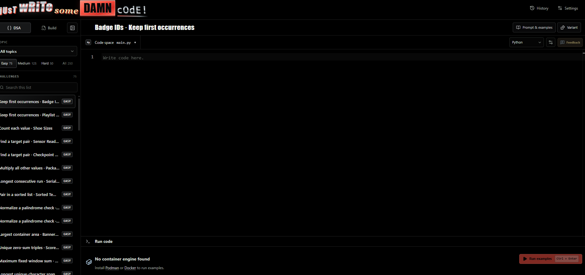
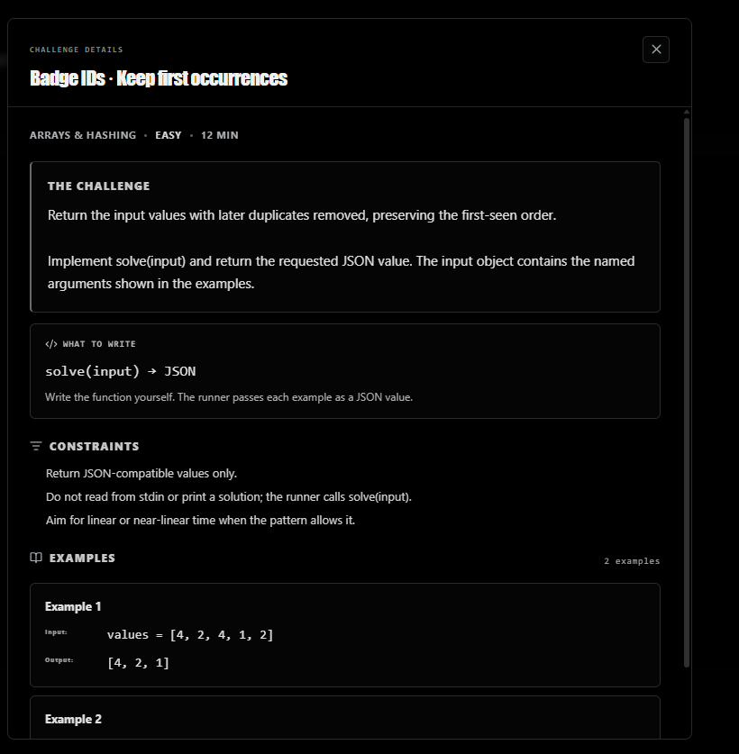
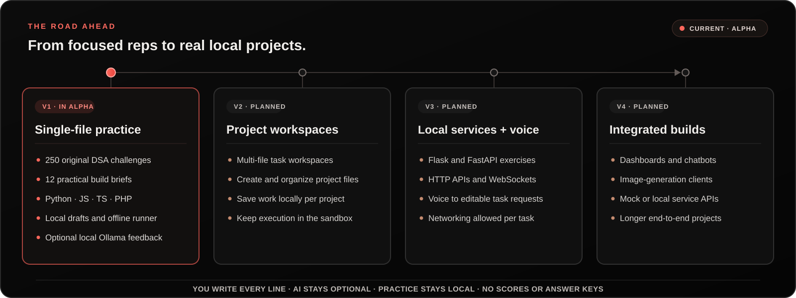

# Just Write Some Damn Code

<p align="center">
  
</p>

<p align="center">
  <a href="https://github.com/devmunro/just-write-some-damn-code/releases"></a>
  <a href="https://github.com/devmunro/just-write-some-damn-code/actions/workflows/validate.yml"></a>
  
  
  
  
</p>

<p align="center"><strong>Pick a challenge. Write every line. Keep your skills sharp.</strong></p>

<p align="center">
  <a href="https://github.com/devmunro/just-write-some-damn-code/releases"><strong>Download the alpha</strong></a>
  · <a href="#the-roadmap">See the roadmap</a>
  · <a href="docs/ARCHITECTURE.md">Read the architecture notes</a>
</p>

Choose a task, write your own code, and run it against public examples. The editor gives you syntax coloring and configurable typing conveniences. AI feedback is optional and stays local. There are no AI completions, starter solutions, answer keys, scores, or leaderboards.

## Take a look



<p align="center"></p>

## What you can practice

| DSA challenges | Build tasks | Languages | Practice data |
| --- | --- | --- | --- |
| 250 original exercises | 12 single-file briefs | Python, JavaScript, TypeScript, PHP | Saved on your device |

- **A steady difficulty curve:** 75 Easy, 125 Medium, and 50 Hard DSA exercises. Build tasks also include all three levels.
- **Useful patterns:** arrays and hashing, two pointers, sliding windows, binary search, stacks and queues, linked lists, trees and tries, heaps, graphs, backtracking, dynamic programming, greedy methods, intervals, bit manipulation, and math and geometry.
- **A small, consistent run format:** implement `solve(input)` and return JSON. Each task includes public input and expected-output examples.
- **An editor that leaves the thinking to you:** Monaco syntax highlighting, with suggestions and inline completions disabled. Indentation and bracket or quote closing can be set per language.
- **Local progress:** drafts are saved per exercise and language. History remembers passed exercises without storing or displaying solutions. There are no accounts or cloud sync.

## The roadmap

The app is in alpha. The roadmap grows the kinds of projects you can practice while keeping the same promise: **you write the code; the tools stay out of the way.** No dates are attached to planned versions.

<p align="center">
  
</p>

## Download and install

Get the installers and SHA-256 checksums from the [GitHub Releases page](https://github.com/devmunro/just-write-some-damn-code/releases):

| Computer | Download |
| --- | --- |
| Windows x64 | `*-x64-setup.exe` |
| Mac with Apple silicon | `*aarch64.dmg` |
| Mac with Intel | `*x64.dmg` |

Run the Windows setup file. On Mac, open the DMG and drag the app into Applications. These alpha packages are not signed by a commercial publisher or notarized, so Windows or macOS may ask you to confirm the app on first launch. Installing the desktop app does not require Node.js or Rust.

### Run code examples

Running code requires [Podman](https://podman.io/docs/installation) or [Docker](https://docs.docker.com/get-started/get-docker/). In the app, choose **Set up runner** once. That downloads the base image and builds the local runner image; after setup, user code runs without network access. The container uses a read-only root filesystem, a temporary workspace, a non-root user, and CPU, memory, process, time, and output limits.

The app remains useful without a container engine: browse challenges, write code, and save drafts. On Windows and Mac, Podman uses a Podman machine; start it before setting up the runner.

## Optional local AI

Install [Ollama](https://ollama.com/download) and a model on the same computer, then choose **Find installed models** in Settings. Ask for a challenge variant or qualitative feedback only when you want it. Variants are labeled and validated; feedback suggests improvements or a next task, without giving a solution or score. AI output is never executed, and the editor has no AI autocomplete.

## Build from source

Install Node.js, the [Rust toolchain](https://rustup.rs/), and the platform requirements in the [Tauri v2 guide](https://v2.tauri.app/start/prerequisites/). Then:

```bash
git clone https://github.com/devmunro/just-write-some-damn-code.git
cd just-write-some-damn-code
npm ci
npm run tauri dev
```

To work on the browser interface without Rust, run `npm run dev`. Browser mode supports writing and local drafts but does not include the native code runner. Before opening a change, run:

```bash
npm run check
npm test
npm run build
```

## How it is built

| Part | Technology | Purpose |
| --- | --- | --- |
| Desktop app | Tauri 2, Rust | Native window, SQLite storage, local commands, and sandbox boundary |
| Interface | Svelte 5, TypeScript, Vite | Challenge browsing, editor workspace, settings, and history |
| Code editor | Monaco | Language-aware editing without autocomplete suggestions |
| Local AI | Ollama on loopback | On-demand variants and qualitative feedback |
| Code runner | Podman or Docker | Disposable offline containers for the four supported languages |

See [the architecture notes](docs/ARCHITECTURE.md) for the run protocol, storage, content rules, and future extension points.

## Content, licensing, and contributing

All included exercises are original and use broad topic coverage only. The app links to [NeetCode 250](https://neetcode.io/practice/practice/neetcode250) and [LeetCode Top Interview 150](https://leetcode.com/studyplan/top-interview-150/) as external references; it does not scrape or redistribute their questions and is not affiliated with either service.

The project license has not been selected yet. Public access does not grant permission to reuse or redistribute the code. See [CONTRIBUTING.md](CONTRIBUTING.md) for contribution and exercise-writing guidelines.
